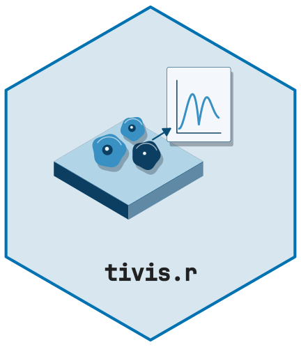

<!-- cttir-vignette-logo: start -->
<style>
.cttir-vignette-logo { float: right; width: 120px; max-width: 30%; margin: 0 0 1rem 1.5rem; }
.cttir-vignette-logo img { width: 100%; height: auto; border: 0; background: transparent; box-shadow: none; }
.cttir-vignette-logo .cttir-vignette-logo-light { display: block; }
.cttir-vignette-logo .cttir-vignette-logo-dark { display: none; }
@media (prefers-color-scheme: dark) {
  .cttir-vignette-logo .cttir-vignette-logo-light { display: none; }
  .cttir-vignette-logo .cttir-vignette-logo-dark { display: block; }
}
[data-bs-theme="light"] .cttir-vignette-logo .cttir-vignette-logo-light { display: block; }
[data-bs-theme="light"] .cttir-vignette-logo .cttir-vignette-logo-dark { display: none; }
[data-bs-theme="dark"] .cttir-vignette-logo .cttir-vignette-logo-light { display: none; }
[data-bs-theme="dark"] .cttir-vignette-logo .cttir-vignette-logo-dark { display: block; }
</style>
<div class="cttir-vignette-logo">
  
  
</div>
<!-- cttir-vignette-logo: end -->

<style>
/* The pkgdown article header already shows the logo; hide this copy there. */
.template-article .cttir-vignette-logo { display: none; }
</style>

```{r setup, include = FALSE}
knitr::opts_chunk$set(collapse = TRUE, comment = "#>")
library(tivis.r)
```

The Diaspective Vision TIVITA Suite writes each capture as a directory
containing a binary `*_SpecCube.dat` cube, a `*_meta.log` acquisition record,
and a set of PNG parameter maps the Suite computed itself. `tivis.r` reads all
three. It needs no vendor SDK and contains no compiled code, which is the main
practical difference from its Cubert counterpart, `cuvis.r`.

Everything below runs against a small example recording bundled with the
package, so it works without access to clinical data.

```{r}
f <- tivis_example_file()
basename(f)
```

## Inspecting before reading

A full TIVITA cube is roughly 123 MB. When surveying an archive you rarely want
the samples, so read the header alone — it is a 12-byte read regardless of file
size.

```{r}
tivis_read_header(f)
```

The header carries `width`, `height` and `bands`. Note the ordering: the header
is `(width, height, bands)`, but the array you get back is
`(rows, cols, bands)` — height first — to match the convention used by
`hyperspectR::hsi_cube()`.

## Reading a cube

```{r}
cube <- tivis_read_cube(f)
dim(cube)
range(attr(cube, "wavelengths"))
```

The wavelength axis is attached as an attribute. It is the nominal axis of
the camera, 500–995 nm in 5 nm steps across the native 100 bands; the file
itself stores no wavelengths.

```{r}
head(tivis_get_wavelengths(100L))
```

The array is ordinary R data, so base graphics are enough for a first look.
Row 1 is the top of the image, which is why the y axis below runs downwards.
The bundled example is a synthetic 16 × 12 pixel cube with eight bands: a
disc of higher reflectance on a diagonal gradient. The colour key gives the
scale.

```{r first-look, fig.width = 8, fig.height = 3.4, dpi = 144, out.width = "100%", fig.alt = "Two panels. Left: false-colour image of band 4 (515 nm) of the bundled 16 by 12 pixel example cube, with a colour key for reflectance from about 0.15 to 0.48. A disc of high reflectance, about 0.4 to 0.48, sits in the centre of a gradient that rises from about 0.15 in the upper left to about 0.35 in the lower right. The y axis is labelled Row and runs downwards from 1 to 12. Right: mean reflectance of the disc and of the background across the eight bands from 500 to 535 nm. Both curves peak at 515 nm, the disc at about 0.39 and the background at about 0.24."}
wl <- attr(cube, "wavelengths")
band <- cube[, , 4]
disc <- band > mean(range(band))
pal <- hcl.colors(64, "viridis")

op <- par(no.readonly = TRUE)
layout(matrix(1:3, nrow = 1), widths = c(3.8, 0.95, 3.25))

# band image: x is the column, y the row, with row 1 at the top
par(mar = c(4.2, 4.2, 2.6, 0.6), cex = 0.85)
image(
  x = seq_len(ncol(band)), y = seq_len(nrow(band)), z = t(band),
  ylim = c(nrow(band) + 0.5, 0.5), col = pal, useRaster = TRUE,
  yaxt = "n", xlab = "Column (x)", ylab = "Row (y)",
  main = sprintf("Reflectance, band 4 (%d nm)", wl[4])
)
axis(2, at = c(1, 4, 8, 12), las = 1)

# colour key for the band image
par(mar = c(4.2, 0.4, 2.6, 3.4), cex = 0.85)
key <- seq(min(band), max(band), length.out = length(pal))
image(
  x = 1, y = key, z = t(key), col = pal, useRaster = TRUE,
  axes = FALSE, xlab = "", ylab = ""
)
axis(4, las = 1)
box()

# mean spectra of the disc and of everything else
par(mar = c(4.2, 4.2, 2.6, 0.8), cex = 0.85)
spectrum <- function(mask) apply(cube, 3, function(b) mean(b[mask]))
plot(
  wl, spectrum(disc), type = "b", pch = 16, col = "#0072B2",
  ylim = c(0, 0.5), las = 1,
  xlab = "Wavelength (nm)", ylab = "Mean reflectance", main = "Mean spectra"
)
lines(wl, spectrum(!disc), type = "b", pch = 17, lty = 2, col = "#D55E00")
legend(
  "bottomright", legend = c("Disc", "Background"), pch = c(16, 17),
  lty = c(1, 2), col = c("#0072B2", "#D55E00"), bty = "n"
)
par(op)
```

Reading a subset of bands is often enough, for instance when building an RGB
composite:

```{r}
rgb_bands <- tivis_read_cube(f, bands = c(1L, 3L, 5L))
dim(rgb_bands)
attr(rgb_bands, "wavelengths")
```

If the wavelength axis must not be assumed, for instance for another camera
model, `tivis_read_cube_profiled()` reads the same samples and records where
the axis came from: either you declare it, or it stays `NA`.

```{r}
undeclared <- tivis_read_cube_profiled(f)
attr(undeclared, "wavelength_evidence")
attr(undeclared, "wavelengths")

declared <- tivis_read_cube_profiled(f, wavelengths = seq(500, 535, by = 5))
attr(declared, "wavelength_evidence")
```

## Acquisition metadata

The Suite writes an INI-style log with German section names, `latin1`
encoding and comma decimal separators. All three are handled, and values are
coerced to numerics and logicals where that is unambiguous.

```{r}
log_file <- system.file("extdata", "example_meta.log", package = "tivis.r")
meta <- tivis_get_metadata(log_file)
str(meta, max.level = 2)
```

Note that `Intensity Grenzwert`, written as `7,000000`, comes back as the
number `7` rather than a string, while text that merely contains a comma is
left alone. A value the Suite wrote in double quotes is a string and stays
one: the version below is not turned into a number, and an identifier keeps
its leading zeros.

```{r}
meta$Fremdlichterkennung$`Intensity Grenzwert`
meta$SW$Version
meta$Camera$CamID
```

## Whole recordings and archives

`tivis_measurement()` bundles the cube with everything stored beside it:

```{r}
m <- tivis_measurement(f)
names(m)
dim(m$cube)
```

Every artefact of a recording is named `YYYY_MM_DD_HH_MM_SS_<what>`, and
`tivis_parse_timestamp()` reads the acquisition time from that name. The name
holds the wall-clock time of the acquisition computer without a time zone, so
the digits are labelled UTC unless you pass the zone of the recording site.

```{r}
tivis_parse_timestamp("2000_01_01_12_00_00_SpecCube.dat")
tivis_parse_timestamp("2000_01_01_12_00_00_SpecCube.dat", tz = "Europe/Berlin")
```

For a real archive, `tivis_list_measurements()` walks the tree and returns one
row per recording, reading only headers:

```{r eval = FALSE}
ms <- tivis_list_measurements("/archive/tivita")
nrow(ms)
unique(paste(ms$width, ms$height, ms$bands))
```

## A note on the format

TIVITA does not publish a specification. The layout implemented here was
determined empirically, by measuring the periodicity of the sample stream of
real recordings. The autocorrelation of the raw stream peaks at lag 100
(r = 0.95), the band count, with harmonics at 200, 300 and 400: all bands of
a pixel are stored together. The autocorrelation of one extracted band plane
peaks at lag 480 (r = 0.99), the image height, against r = 0.43 at lag 640,
the width: pixels run down columns, not across rows.

An earlier version of this vignette said the layout and the wavelength axis
had been validated against the Suite's own `_RGB-Image.png` export. That
comparison was withdrawn. The exported image is rotated and rescaled relative
to the cube, so it cannot serve as pixel-level ground truth. The wavelength
axis is therefore the nominal one, an assumption of the reader rather than
something measured from the file.

This matters because the failure mode is silent. `array()` recycles without
complaint, so a reader with the wrong dimensions or sample type still returns a
full-size cube; it is simply noise. `tivis_read_header()` therefore checks the
file size against the header and refuses to guess.

## Where this fits

`tivis.r` is a format reader, deliberately narrow. Cube construction,
preprocessing and tissue indices live in
[`hyperspectR`](https://github.com/CTTIR/hyperspectR); publication-grade
rendering lives in
[`hyperspectaculR`](https://github.com/CTTIR/hyperspectaculR).
